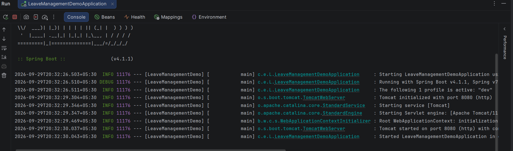
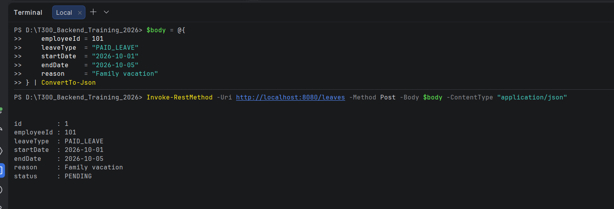
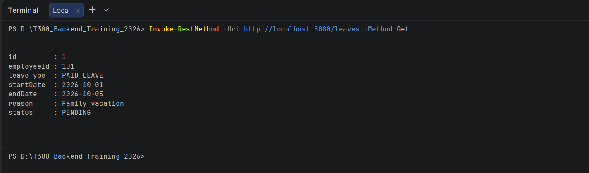
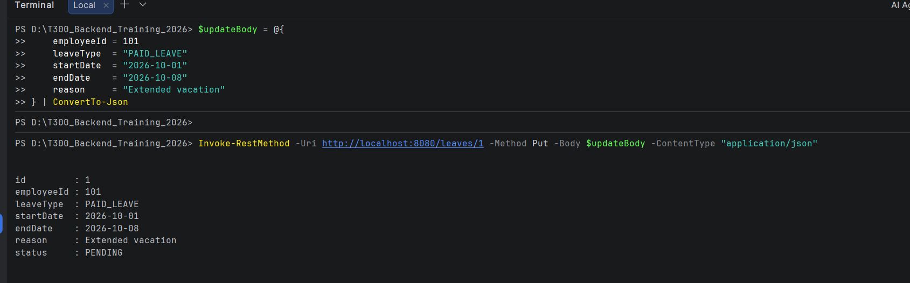
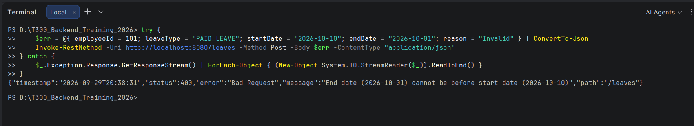
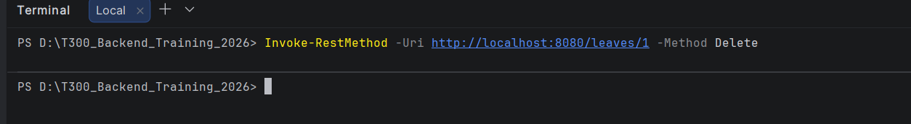
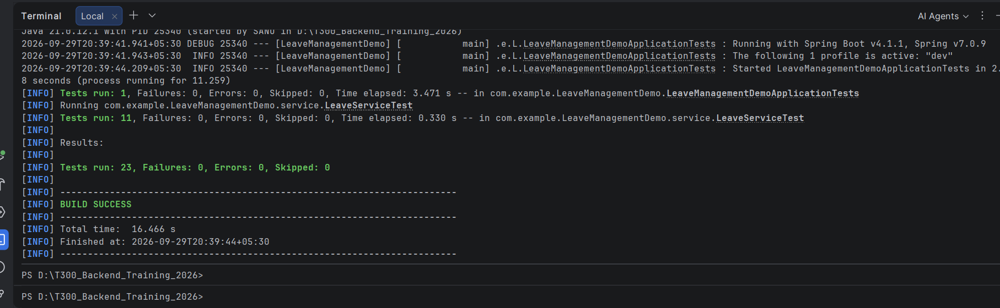

# Leave Management System - Spring Boot REST API

A robust, enterprise-ready Leave Management REST API built using **Spring Boot 4** and **Java 21** following clean layered architecture, constructor-based dependency injection, Bean Validation, comprehensive exception handling, and full test automation.

---

## 📋 Table of Contents
- [Project Overview](#project-overview)
- [Architecture & Package Structure](#architecture--package-structure)
- [Technology Stack](#technology-stack)
- [Configuration & Profiles](#configuration--profiles)
- [Build and Run Instructions](#build-and-run-instructions)
- [API Endpoint Summary](#api-endpoint-summary)
  - [API Endpoints Table](#api-endpoints-table)
  - [Sample Requests & Responses](#sample-requests--responses)
- [Testing Instructions](#testing-instructions)
- [Execution Screenshots](#-execution-screenshots)
- [Deliverables & Submission Checklist](#-deliverables--submission-checklist)

---

## 📌 Project Overview
This application serves as an HR Leave Management API for organizations to allow employees to submit, view, update, and delete leave requests. 

### Key Highlights:
- **Clean Layered Architecture:** Strict separation of concerns (`Controller` → `Service` → `Repository`).
- **Constructor-Based Dependency Injection:** All dependencies are injected via constructors without field injection.
- **In-Memory Thread-Safe Repository:** Uses `ConcurrentHashMap` for high-throughput, thread-safe in-memory operations.
- **DTO Pattern:** Clean separation between Domain Models (`LeaveInfo`) and client-facing DTOs (`LeaveRequest`, `LeaveResponse`).
- **Bean Validation:** Comprehensive input validation (`@NotNull`, `@NotBlank`, `@Size`, etc.) and date range business logic.
- **Global Exception Handling:** Centralized `@RestControllerAdvice` converting exceptions to consistent, structured JSON error responses with standard HTTP status codes.
- **Profiles Support:** Multi-environment configuration (`dev`, `prod`).
- **Full Test Coverage:** 24 unit and MockMvc integration tests.

---

## 🏗️ Architecture & Package Structure

```text
com.example.LeaveManagementDemo/
├── LeaveManagementDemoApplication.java   # Spring Boot Application Entry Point
├── configuration/
│   └── AppConfig.java                    # Application Bean Configurations
├── controller/
│   └── LeaveManagementController.java    # REST Endpoints for /leaves
├── dto/
│   ├── LeaveRequest.java                 # Incoming Request DTO with Bean Validation
│   └── LeaveResponse.java                # Outgoing Response DTO
├── exception/
│   ├── ErrorResponse.java                # Standardized Error Response Structure
│   ├── GlobalExceptionHandler.java       # Centralized @RestControllerAdvice
│   ├── InvalidLeaveDateException.java    # Business exception for invalid date ranges
│   └── LeaveNotFoundException.java       # Exception for non-existent IDs (404)
├── model/
│   ├── LeaveInfo.java                    # Core Domain Entity
│   ├── LeaveStatus.java                  # Status Enum (PENDING, APPROVED, NOT_APPROVED, REJECTED, CANCELLED)
│   └── LeaveType.java                    # Type Enum (PAID_LEAVE, UNPAID_LEAVE, SICK_LEAVE, CASUAL_LEAVE, etc.)
├── repository/
│   └── LeaveRepository.java              # Thread-Safe In-Memory Repository (ConcurrentHashMap)
└── service/
    ├── LeaveService.java                 # Service Interface
    └── LeaveServiceImpl.java             # Business Logic & DTO Mapping Implementation
```

---

## 💻 Technology Stack
- **Java:** OpenJDK 21
- **Framework:** Spring Boot (with Spring WebMVC, Validation, Jackson)
- **Data Store:** In-memory `ConcurrentHashMap`
- **Testing:** JUnit 5, Mockito, Spring Test / MockMvc, Hamcrest
- **Build Tool:** Apache Maven (Wrapper included: `./mvnw` / `mvnw.cmd`)

---

## ⚙️ Configuration & Profiles

Configuration is managed via `application.properties` with support for environment profiles:

| Profile | File | Default Port | Log Level | Environment Name |
| :--- | :--- | :--- | :--- | :--- |
| **Default / Base** | `src/main/resources/application.properties` | 8080 | Default | Active profile: `dev` |
| **Development** | `src/main/resources/application-dev.properties` | 8080 | DEBUG | Development |
| **Production** | `src/main/resources/application-prod.properties` | 8080 | INFO | Production |

To run with a specific profile:
```bash
./mvnw spring-boot:run -Dspring-boot.run.profiles=dev
```

---

## 🚀 Build and Run Instructions

### Prerequisites
- JDK 21 installed and configured on your `PATH`.
- Git.

### 1. Build the Application
On Windows:
```cmd
mvnw.cmd clean package
```
On Linux/macOS:
```bash
./mvnw clean package
```

### 2. Run the Application
On Windows:
```cmd
mvnw.cmd spring-boot:run
```
On Linux/macOS:
```bash
./mvnw spring-boot:run
```
Or run the packaged JAR:
```cmd
java -jar target/LeaveManagementDemo-0.0.1-SNAPSHOT.jar
```

The server starts at `http://localhost:8080` with the `dev` profile enabled.

---

## 📡 API Endpoint Summary

### API Endpoints Table

| Method | Endpoint | Description | Request Body | Success Status | Error Statuses |
| :--- | :--- | :--- | :--- | :--- | :--- |
| **GET** | `/leaves` | Retrieve all leave requests | None | `200 OK` | `500 Internal Server Error` |
| **GET** | `/leaves/{id}` | Retrieve a leave request by ID | None | `200 OK` | `404 Not Found` |
| **POST** | `/leaves` | Create a new leave request | `LeaveRequest` JSON | `201 Created` | `400 Bad Request` |
| **PUT** | `/leaves/{id}` | Update an existing leave request | `LeaveRequest` JSON | `200 OK` | `400 Bad Request`, `404 Not Found` |
| **DELETE** | `/leaves/{id}` | Delete a leave request | None | `204 No Content` | `404 Not Found` |

---

### Sample Requests & Responses

#### 1. Create a Leave Request
**`POST /leaves`**

> **Note:** The `status` field is automatically initialized to `PENDING` by the service on creation and does not need to be provided in the request body.

**Request Headers:**
```http
Content-Type: application/json
```

**Request Body:**
```json
{
  "employeeId": 101,
  "leaveType": "PAID_LEAVE",
  "startDate": "2026-10-01",
  "endDate": "2026-10-05",
  "reason": "Family vacation"
}
```

**Response (`201 Created`):**
```json
{
  "id": 1,
  "employeeId": 101,
  "leaveType": "PAID_LEAVE",
  "startDate": "2026-10-01",
  "endDate": "2026-10-05",
  "reason": "Family vacation",
  "status": "PENDING"
}
```

---

#### 2. Retrieve All Leaves
**`GET /leaves`**

**Response (`200 OK`):**
```json
[
  {
    "id": 1,
    "employeeId": 101,
    "leaveType": "PAID_LEAVE",
    "startDate": "2026-10-01",
    "endDate": "2026-10-05",
    "reason": "Family vacation",
    "status": "PENDING"
  }
]
```

---

#### 3. Retrieve Leave by ID
**`GET /leaves/1`**

**Response (`200 OK`):**
```json
{
  "id": 1,
  "employeeId": 101,
  "leaveType": "PAID_LEAVE",
  "startDate": "2026-10-01",
  "endDate": "2026-10-05",
  "reason": "Family vacation",
  "status": "PENDING"
}
```

---

#### 4. Update an Existing Leave Request
**`PUT /leaves/1`**

**Request Body:**
```json
{
  "employeeId": 101,
  "leaveType": "PAID_LEAVE",
  "startDate": "2026-10-01",
  "endDate": "2026-10-07",
  "reason": "Extended vacation"
}
```

**Response (`200 OK`):**
```json
{
  "id": 1,
  "employeeId": 101,
  "leaveType": "PAID_LEAVE",
  "startDate": "2026-10-01",
  "endDate": "2026-10-07",
  "reason": "Extended vacation",
  "status": "APPROVED"
}
```

---

#### 5. Delete a Leave Request
**`DELETE /leaves/1`**

**Response (`204 No Content`)**

---

#### 6. Error Handling Example (Validation Failure)
**`POST /leaves` with invalid dates (`endDate` before `startDate`):**
```json
{
  "employeeId": 101,
  "leaveType": "PAID_LEAVE",
  "startDate": "2026-10-10",
  "endDate": "2026-10-01",
  "reason": "Trip"
}
```

**Response (`400 Bad Request`):**
```json
{
  "timestamp": "2026-09-29T19:50:00",
  "status": 400,
  "error": "Bad Request",
  "message": "End date (2026-10-01) cannot be before start date (2026-10-10)",
  "path": "/leaves"
}
```

---

## 🧪 Testing Instructions

Run all tests via the Maven wrapper:
```cmd
mvnw.cmd test
```
*(or `./mvnw test` on Linux/macOS)*

### Test Suite Structure:
- **`LeaveServiceTest`**: 12 unit tests validating all business logic, date rules, ID generation, and exception scenarios.
- **`LeaveManagementControllerTest`**: 11 MockMvc integration tests verifying HTTP endpoints, JSON serialization/deserialization, HTTP response codes (200, 201, 204, 400, 404), and error handling.
- **`LeaveManagementDemoApplicationTests`**: Verifies Spring application context bootstrapping.

---

## 📸 Execution Screenshots

As required by the assignment deliverables, screenshots demonstrating successful application startup, REST API execution, and test suite execution are included in the [`deliverables/`](deliverables/) folder:

### 1. Successful Application Startup
Shows the Spring Boot application starting on port `8080` with the `dev` profile active:


### 2. Successful Execution of REST APIs
- **Create Leave Request (`POST /leaves`):**
  

- **Retrieve All Leave Requests (`GET /leaves`):**
  

- **Update Leave Request (`PUT /leaves/1`):**
  

- **Global Exception Handling & Validation Error (Invalid Date Range):**
  

- **Delete Leave Request (`DELETE /leaves/1`):**
  

### 3. Successful Execution of Test Suite
Shows Maven executing all unit and controller tests with `BUILD SUCCESS`:


---

## 📋 Deliverables & Submission Checklist

- [x] **Source code**: Committed on branch `sanjeev/springboot_assignment`.
- [x] **Layered Architecture**: Controller → Service → Repository.
- [x] **Constructor DI**: Implemented across all layers.
- [x] **DTOs & Bean Validation**: Input validation with `@Valid`.
- [x] **Global Exception Handling**: `@RestControllerAdvice` handling custom and system exceptions.
- [x] **Configuration & Profiles**: `dev` and `prod` profiles configured.
- [x] **Service Unit Tests**: 11 JUnit 5 / Mockito unit tests.
- [x] **Controller MockMvc Tests**: 11 MockMvc tests.
- [x] **README.md**: Complete documentation, API summary, and screenshot links.
- [x] **Screenshots**: Saved in [`deliverables/`](deliverables/) folder.
